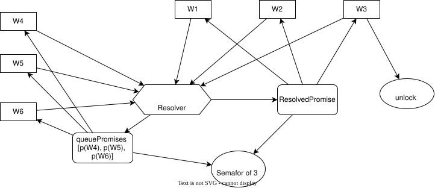

# Semafor

Суть семафора та же что и у мьютекса, но он допускает работу нескольких воркеров вместе, например 3 воркера могут работать остальные должны подождать пока слот не освободится.

Если думать о реализации на js то в голову приходит использовать те же промисы но набивая в один промис группу воркеров, следующих воркеров ооставлять в ожидании когда промис разрешится

## Своя реализация

Идея такая, под каждый воркер в создается новый промис, эти промисы пишутся в очередь, или даже лучше в HashSet
когда конкретный промис отработал вызывается его функция resolve и промис удаляется из HashSet, также происходит проверка
если в HashSet size меньше чем size семафора значит из очереди берем следуюий промис и добавляем в HashSet.

### Текстовая реализация

Версия 1

1. Имеем метод lock у объекта семафора, size у семафора 1, activePromises для отслеживания работающих промисов, delayedPromises для постановки в очередь
2. Пришел новый запрос, создаем для него промис
3. При реализации я должен хранить не activePromises а activeUnlocks чтобы самому разблокировать какие-то промисы.

То есть я достаю из очереди первый элемент . Как тогда я 