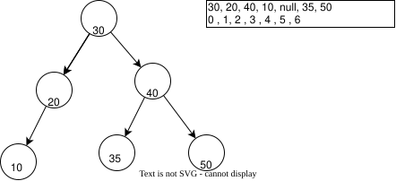
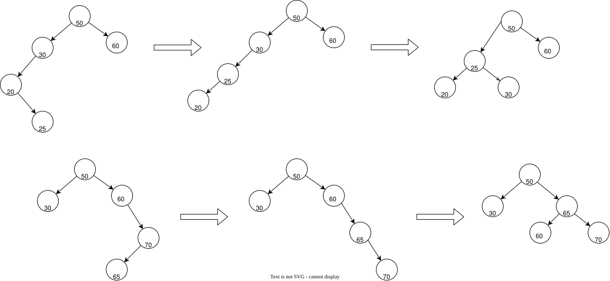

# TreeSet

Множество в виде дерева O(logn).

Является бинарным сбалансированным деревом. Объекты класса TreeSet представляют собой множество в которое можно добавить элемент удалить элемент и проверить существование элемента в множестве за логарифмическое время.

Можно использовать например логику AVL дерева для балансировки, либо красно-черные деревья.

```sh
node ./TreeSet.js
```

## AVL дерево

Для перебалансировки нужно знать высоту каждого узла


## Бинарное дерево

Инварианты бинарного дерева которое хранится в массиве и само бинарное дерево



## Основной выводи из работы с этими структурами

Я хотел представить дерево в виде массива, думал это удобно во всех случаях но это не так. Для сбалансированного бинарного дерева удобнее работать с объектами а не структурами, потому что нужно выполнять проверки при вставке нового элемента.

Представлять дерево массивом удобно для определения более конкретных свойств например MinHeap когда нужно поддерживать именно какое-то своство структуры

## Балансировка

Чтобы поиск был быстрым дерево должно быть сбалансированным, использую для этого AVL алгоритм

Правила поворотов



Если я увидел дисбаланс проверяем либо левый либо правый узел чтобы понять в какую сторону дисбаланс
и какой это случай LL, LR, RL или RR , LL и RR можно выполнить за один поворот, LR и RL за 2.

# Операционная модель поворотов

**Условия:**

- Оперируем конкретным узлом поворачиваем один конкретный узел

**Не известное:**

- Заранее не известно с какой стороны узел стоит у родителя. может стоять как справа так и слева и это положение должно сохраниться.

**Операции:**

1. Получить узел для поворота
2. Взять родителя этого узла.
3. Если родителя нет то в зависимости от направления поворота поставить дочернему узлу текущий узел в правильный слот а у дочернего убрать родителя.
4. Если родитель есть, определить слот текущего узла у родителя, в слот родителя добавить дочерний элемент дочернему задать нового родителя, текущий поставить в слот дочернего, текущему родителем задать дочерний.

## Смысловая модель

Добавление нового узла:

- Вставить новый узел в правильную позицию в соответствии с BST инвариантом, все что левее меньше всего того что правее
- Рассчитать правильную высоту поддерева каждого узла
- На основе высоты сделать перебалансировку в соответствии с AVL инвариантом

Повороты:
Левый поворот для N

- Запомнить родителя узла на котором делаем поворот R
- Правый потомок N Назвать NR
- NR получает родителя R
- Левый потомок NR назвать NRL
- N получает родителя NR
- N встает слева от NRL
- N в право получает NRL

## Операционная модель

Состояния , корректность которых нужно поддерживать

- Высота узла, всегда должна быть корректной

Процесс процессов вставки узла:

- Определить место нового узла в дереве
- Создать новый узел и добавить в дерево
- Пересчитать высоты дерева
- Перебалансировать дерево на основе высот.
- Каждому перебалансированному узлу пересчитать высоты + пересчитать восоты родителя перебалансированного узла и всех его  родителей.

Предусловия:

- Приходит значение нового элемента для вставки
- Может прийти кандидат которому нужно добавить потомка
   Процесс определения места узла в дереве:
- Проверить что в дереве нет лидера, при успехе

   - Новый узел сделать лидером, выйти из процесса

- Взять кандидата, например лидера, или кандидата прошлой итерации.
- Проверить равно ли значение кандидата значению вставляемого элемента, при успехе

   - Выйти из процесса, дубли не вставляем в дерево

- Проверить что новый элемент меньше кандидата, при успехе

   - Проверить что у кандидата задан левый потомок, при успехе

      - Повторить процесс добавления узла где кандидат - левый потомок

   - Левый потомок не задан

      - Создать элемент, который станет левым потомком кандидата.

- Проверить что новый элемент больше кандидата, при успехе

   - Проверить что у кандидата задан правый потомок, при успехе

      - Повторить процесс для кандидата - правый потомок

   - Правый потомок не задан

      - Создать элемент, который станет правым потомком кандидата

Процесс создания узла:

- Создать новый объект узла
- ПРоверить что создание вызвано с родителем
   - Для привязать новый узел в слот родителя.
   - Выполнить баблинг для пересчета высот поддеревьев родителей
   - Выполнить перебалансировку от нового узла

Процесс перебалансировки от вставленного элемента вверх:

- Прочитать высоту левого поддерева и правого поддерева
- Посчитать разницу между левым и правым поддеревом
- Проверить что разница больше 2 (нужно балансировать левую сторону)

   - Проверить что у левого потомка есть правый потомок

      - Выполнить LR поворот сначала влево потом вправо

   - Проверить что правого потомка нет

      - Выполнить правый поворот

- Проверчить что разница меньше -2

   - Выполнить те же действия что для левого поворота, но с обратными значениями веток, для правого поддерева

## Сомнения

- Я не понимаю в каком порядке мне организовать пересчет высот и перебалансировку
- Каждому процессу нужно описание предусловий

## Озарения

- Я понял что самое сложное это понять как правильно посчитать высоту новых элементов после перебалансировки, возможно я вообще не правильно считаю высоты поддеревьев?

## Смысловая модель удаления узла

- Найти узел по значению
- У узла есть один потомок -> привязать этого потомка к родителю.
- У узла 2 потомка. кого привязать?
- Термин successor - преемник
- 4 случая возможных
   - Удаляемый узел - лист, не имеет потомков -> удаляем его у родителя
   - Имеет правого потомка -> потомок становится на место удаляемого узла или корнем
   - Имеет левого потомка -> потомок становится на место удаляемого, либо становится корнем
   - Имеет обоих потомков, преемником может быть
      - либо наибольшее значение в левом поддереве
      - либо наименьшее значение в правом поддереве
      - Выбрать из двух узлов можно тот у которого наименьшее поддерево, в идеале взять лист
      - У найденного преемника мы его заменяем на место удаляемого узла, связываем левые правые и родителя от удаляемого узла
      - Если у найденного саксесора есть обратный слот от того что мы искали то этот слот мы привязываем к слоту в котором стоял приемник у родителя